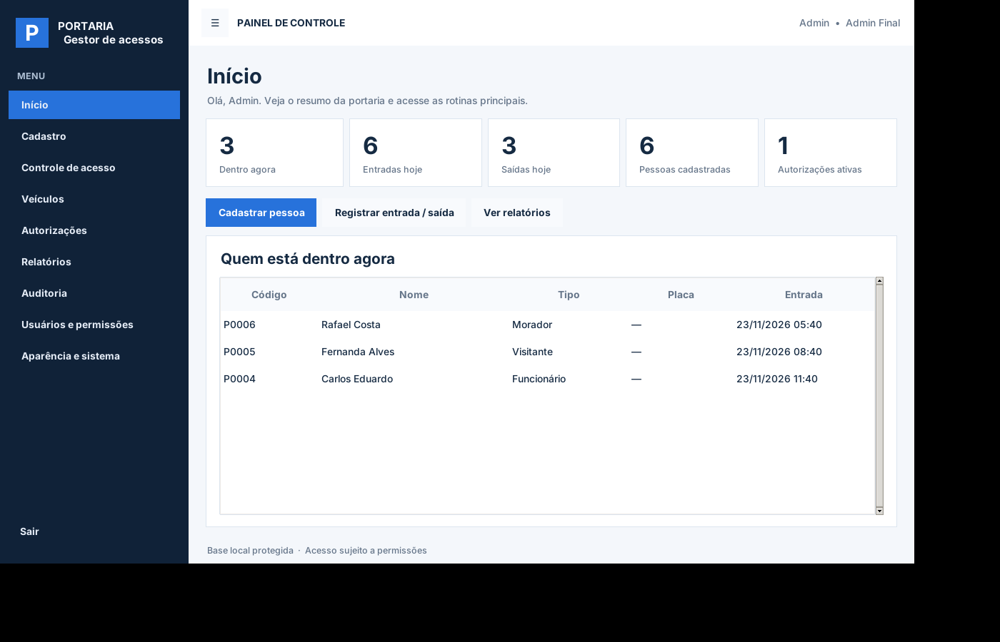
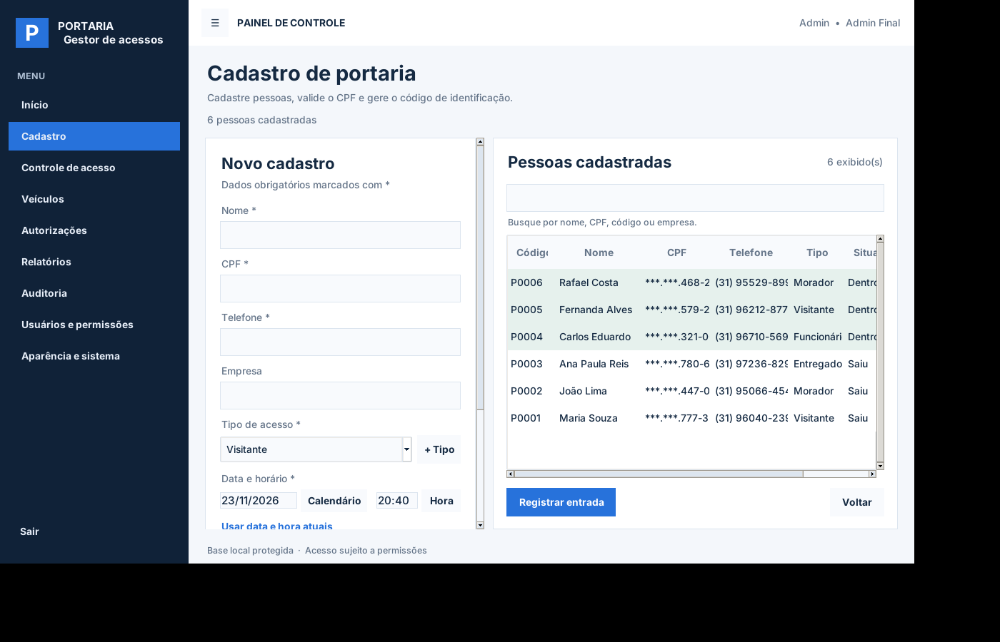
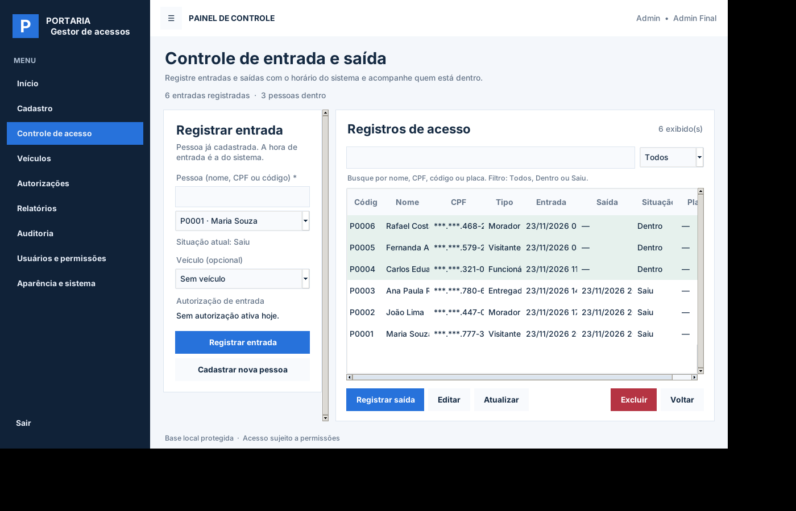
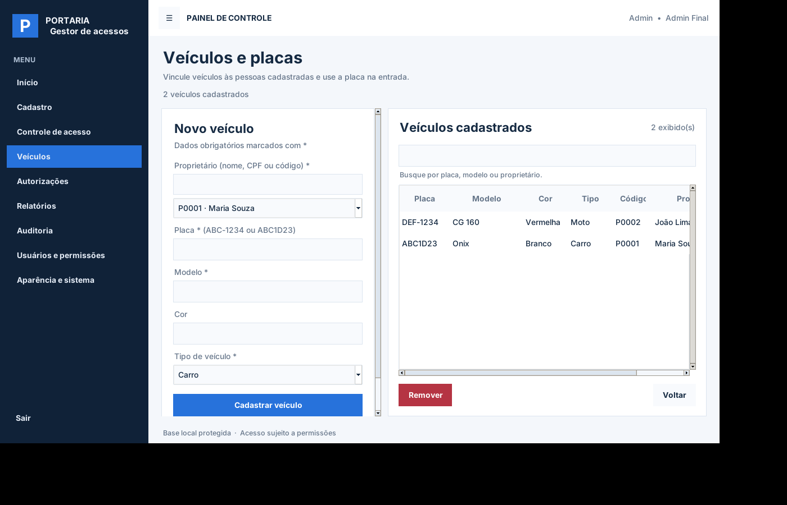
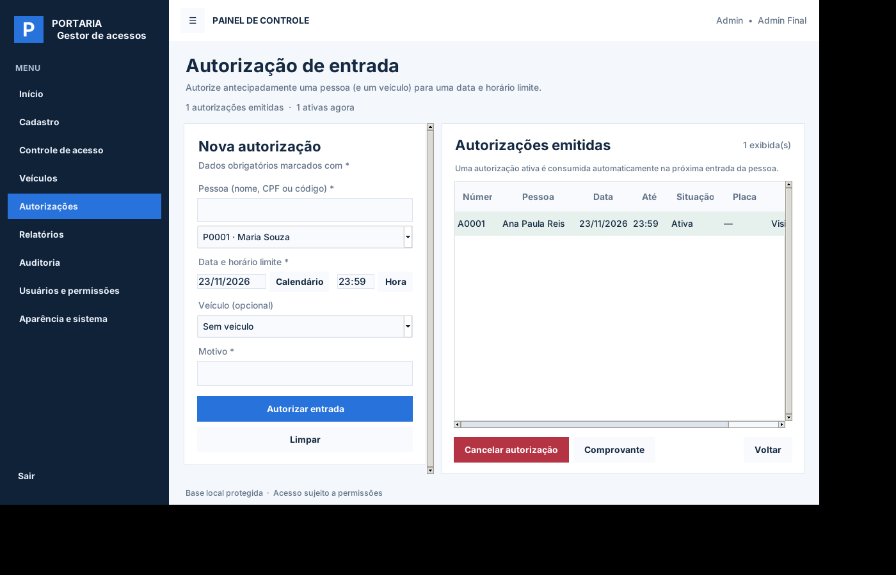
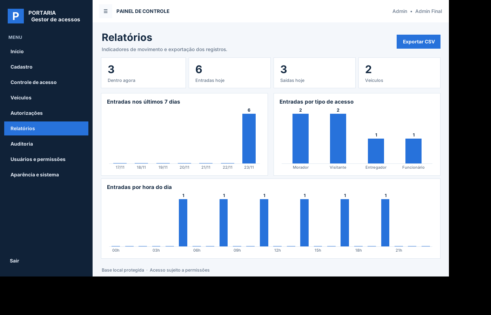

# A3-PORTARIA2026 — Portaria 2.1

**Sistema de Portaria**: aplicativo desktop (Python + Tkinter) para cadastrar pessoas, controlar entradas e saídas, vincular veículos e placas, emitir autorizações de entrada, gerar relatórios e manter auditoria, com dados protegidos em um **cofre local criptografado (AES-256-GCM)**.

Trabalho A3 da disciplina **Teoria da Computação e Compiladores** — Ciência da Computação, Faculdade UNA. Orientação: **Prof.ª Cíntia Silvana de Souza**.

## Autores

| Nome | |
|---|---|
| **Lucas Augusto Morais Carvalho** | desenvolvimento e documentação |
| **Lucas Andrian Pieroni** | desenvolvimento e documentação |

**Versão atual:** 2.1.3 · Python 3.10+ · Licença/uso: trabalho acadêmico (sem licença de redistribuição definida).

## Funcionalidades

| Tela | O que faz |
|---|---|
| **Login** | E-mail ou CPF, logo, **Limpar**, bloqueio de campos vazios, *Mostrar senha*, bloqueio após 5 tentativas, recuperação de senha |
| **Início** | Indicadores do dia, atalhos e quem está dentro agora |
| **Cadastro** | Nome\*, CPF\* (validado e único), Telefone\*, Empresa, Tipo\*, Data\*, Horário\*, Motivo\*; gera código `P0001…`; botões Cadastrar / Limpar / Cancelar; máscaras de digitação |
| **Controle de acesso** | Busca (nome, CPF, código, placa), filtro Todos/Dentro/Saiu, tabela Código · Nome · CPF · Tipo · Entrada · Saída · Situação · Placa; Registrar entrada/saída com horário do sistema; bloqueio de entrada dupla |
| **Veículos** *(extra)* | Placas antigas e Mercosul vinculadas às pessoas |
| **Autorizações** *(extra)* | Autorização antecipada com horário limite, consumida na entrada; comprovante em HTML |
| **Relatórios** | Indicadores, gráficos (7 dias, por tipo, por hora) e exportação CSV |
| **Auditoria / Usuários / Aparência** | Trilha de eventos, gestão de usuários e papéis, temas Claro · Escuro · Floresta |

Requisitos técnicos do roteiro atendidos: `Entry`, `Button`, `Label`, `Combobox`, `Checkbutton` e `Treeview`; decisão e repetição; funções; tratamento de erros nas camadas de serviço e de interface.

## Capturas de tela

| Início | Cadastro | Controle de acesso |
|---|---|---|
|  |  |  |

| Veículos | Autorizações | Relatórios |
|---|---|---|
|  |  |  |

## Instalação e execução

```bash
git clone https://github.com/<usuario>/A3-PORTARIA2026.git
cd A3-PORTARIA2026
python -m pip install -r requirements.txt
python cadastro_portaria.py
```

- No Windows, use `py` se `python` não for reconhecido. No Ubuntu/Debian, instale o Tkinter: `sudo apt install python3-tk`.
- Pasta de dados separada: `python cadastro_portaria.py --data-dir "C:\DadosPortaria"` (ou variável `PORTARIA_DATA_DIR`).
- Na **primeira execução** é criado o Admin Final e exibido **uma única vez** o código de recuperação do cofre — anote-o.

## Testes

```bash
python -m pip install -r requirements-dev.txt
python -m pytest -q                 # Linux sem display: xvfb-run -a python -m pytest -q
```

Suíte atual: **60 testes** (domínio, serviço, cofre e interface). Relatório de QA no Windows em [docs/PLANO_DE_TESTES_E_QA.md](docs/PLANO_DE_TESTES_E_QA.md).

## Documentação

| Documento | Conteúdo |
|---|---|
| [SRS — Especificação de Requisitos](docs/SRS_PORTARIA_2_1.md) | Requisitos funcionais e não funcionais, regras de negócio, permissões, casos de uso, rastreabilidade |
| [Manual do usuário](docs/MANUAL_DO_USUARIO.md) | Instalação, uso de cada tela, backup e solução de problemas |
| [Arquitetura](docs/ARQUITETURA_V2.md) | Camadas, fluxos críticos, decisões de projeto |
| [Modelo de dados](docs/MODELO_DE_DADOS.md) | Seções do cofre, campos, relacionamentos, formato do arquivo |
| [Plano de testes e QA](docs/PLANO_DE_TESTES_E_QA.md) | Estratégia, casos de teste, defeitos e correções |
| [Segurança e limitações](docs/SEGURANCA_E_LIMITACOES.md) | Modelo de ameaças e operação recomendada |
| [Heurísticas de UX](docs/UX_HEURISTICAS.md) | Verificação das heurísticas de usabilidade |
| [Histórico de mudanças](CHANGELOG.md) | Versões 2.1.0 a 2.1.3 |
| [SRS da v6 (histórico)](docs/historico/SRS_v6_historico.md) | Documento acadêmico anterior |

## Estrutura do projeto

```text
cadastro_portaria.py              ponto de entrada, lock de instância, configuração
requirements.txt / -dev.txt       dependências (cryptography; pytest nos testes)
portaria/
  config.py                       formatos, constantes e regras compartilhadas
  domain/                         validação (CPF, telefone, placa, datas), permissões RBAC, segurança
  application/                    PortariaService (fachada) e casos de uso:
                                  access_ / gate_ / identity_operations, vault_lifecycle
  infrastructure/                 cofre AES-GCM, importação legada, lock de instância
  presentation_v2/                interface Tk/ttk: app, tema, login, cadastro, controle,
                                  veículos, autorizações, relatórios, auditoria, usuários
tests/                            testes automatizados
docs/                             documentação e capturas de tela
```

Os serviços não importam Tkinter; a interface apenas chama o `PortariaService`, e toda permissão é verificada na camada de serviço.

## Segurança em resumo

Dados cifrados em repouso (AES-256-GCM, PBKDF2 600 000 iterações), gravação atômica, controle de concorrência otimista, lock de instância, autorização por cargo no serviço e auditoria. **Não** substitui proteção do sistema operacional nem backup: veja [limitações](docs/SEGURANCA_E_LIMITACOES.md). **Nunca publique** `dados_portaria.enc`, logs ou backups — o `.gitignore` já os exclui.

## Permissões por papel

| Funcionalidade | Admin Final | Adm | Usuário |
|---|:---:|:---:|:---:|
| Consultar e pesquisar registros | Sim | Sim | Sim |
| Cadastrar pessoa, registrar entrada e tipo temporário | Sim | Sim | Sim |
| Registrar saída ainda vazia | Sim | Sim | Sim |
| Cadastrar veículos e placas | Sim | Sim | Sim |
| Emitir/cancelar autorização de entrada | Sim | Sim | Não |
| Exportar CSV | Sim | Sim | Não |
| Remover veículos | Sim | Sim | Não |
| Editar dados / corrigir saída já preenchida | Sim | Sim | Não |
| Excluir registros | Sim | Sim | Não |
| Consultar auditoria | Sim | Sim | Não |
| Criar/excluir contas, alterar papéis, desbloquear | Sim | Não | Não |
| Mudar tema da própria interface | Sim | Sim | Sim |

Papel do usuário é obtido da conta autenticada, nunca de uma opção escolhida no login.

## Dados, abertura do cofre e migração

- A aplicação usa `dados_portaria.enc` com **sete conjuntos de dados lógicos** (registros, auditoria, tipos temporários, usuários e, desde a 2.1, pessoas, veículos e autorizações), preservando o **formato binário v2**.
- O Admin Final desbloqueia o cofre ao iniciar; depois os funcionários entram usando suas próprias credenciais. O sistema não grava a senha de desbloqueio em claro.
- O código de recuperação aleatório é mostrado **uma única vez**, na criação/migração; guarde-o fora do computador. Recuperação de senha de usuários continua separada do desbloqueio do cofre.
- Em uma instalação antiga **sem cofre**, faça backup dos quatro arquivos `registros_portaria.csv`, `auditoria_portaria.csv`, `tipos_temporarios.csv`, `usuarios_portaria.json`, coloque-os no diretório de dados e escolha migrar. A criptografia exige a senha atual do Admin Final; os originais legíveis são removidos da pasta ativa após o commit do cofre.
- Em instalação com cofre existente, **copie apenas o cofre válido para o diretório de dados**, sem os CSV/JSON legíveis, e informe a senha ou o código de recuperação ao abrir. Não é necessária conversão adicional.
- `dados_portaria.lock` é um arquivo auxiliar para o bloqueio entre processos; pode permanecer depois de uma execução. O bloqueio é do sistema operacional e é liberado ao encerrar o processo. **Não apague ou edite o cofre enquanto estiver aberto.**
- `ui_settings.json` guarda somente o tema. `portaria.log` registra erros técnicos. Esses arquivos não fazem parte do cofre.

**Backup obrigatório:** copie `dados_portaria.enc` regularmente para armazenamento seguro e externo, com a aplicação fechada. Guarde a senha/código de recuperação separadamente. Uma gravação atômica evita arquivo parcialmente escrito, mas não substitui backups.

## Limitações conhecidas

1. **Não é um servidor nem uma solução de segurança contra administradores da máquina.** Quem pode modificar scripts Python, copiar ou substituir arquivos locais pode negar serviço ou restaurar um cofre antigo. O sistema não impede rollback de backup, cópia da base ou ataques ao próprio computador. Use permissões de pasta do SO e backup externo.
2. **O desbloqueio pelo Admin Final é exigido a cada abertura** (concepção mantida por compatibilidade). Não é ideal para múltiplos turnos independentes e não há acesso simultâneo em rede. A chave fica na memória do processo enquanto a aplicação está aberta.
3. A recuperação por três palavras em múltipla escolha é uma funcionalidade **legada com entropia limitada**. O bloqueio por tentativas e o token de recuperação reduzem, mas não eliminam, o risco. Em ambiente real, preferir recuperação independente, MFA e política de credenciais mais forte.
4. Tk/ttk é um toolkit **desktop**. Esta versão se adapta às dimensões da janela, mas não é uma interface mobile, nem garante equivalência pixel a pixel em Windows/Linux/macOS. Testes gráficos automatizados foram feitos em display virtual Linux; faça aceite visual e de acessibilidade no Windows de destino.
5. O cofre regrava o documento criptografado inteiro em cada operação. Essa arquitetura, deliberadamente preservada, terá gargalos conforme a base e a auditoria crescerem. O lock entre instâncias evita competição apenas entre aplicações que respeitem o mesmo arquivo de lock.
6. O projeto acadêmico não foi submetido a auditoria de segurança independente nem tem contrato de suporte de produção.

## Histórico e autoria

Evolução do projeto acadêmico **Cadastro de Portaria v6** (Teoria da Computação e Compiladores, Faculdade UNA), desenvolvido por **Lucas Augusto Morais Carvalho** e **Lucas Andrian Pieroni** sob orientação da Prof.ª Cíntia Silvana de Souza. A versão 2.0 redesenhou a interface e a arquitetura; a 2.1 incorporou o roteiro "Sistema de Portaria" (A3) e os extras de veículos/placas e autorização de entrada.
